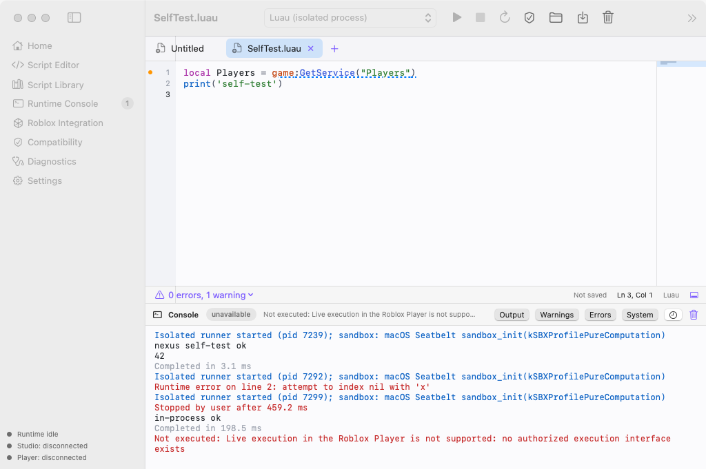
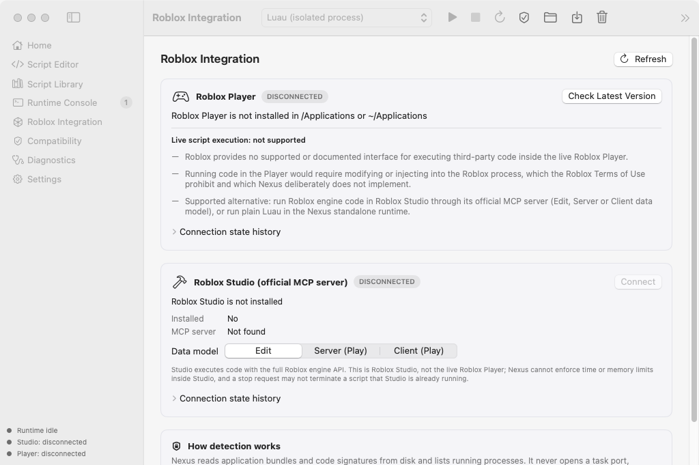
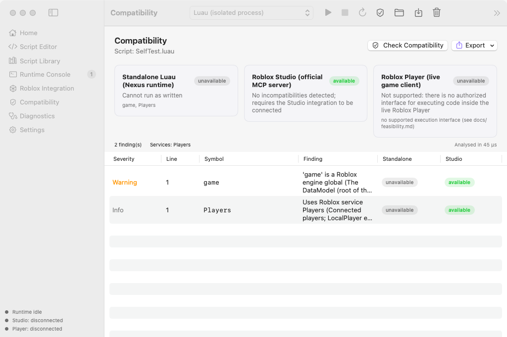

# Nexus

[](https://github.com/AJJazzy/Exec/actions/workflows/ci.yml)

A native macOS scripting environment for Luau, built around a C++20 core and the official
[Luau](https://github.com/luau-lang/luau) implementation, with a SwiftUI + AppKit interface.

> **Read this first: Nexus does not execute scripts inside the live Roblox Player.** I researched
> whether any supported or authorized interface allows it on macOS, and none does. The Player is
> signed with the Hardened Runtime and has no debugger, DYLD or library-validation exceptions, so
> any such technique would require defeating macOS protections or modifying the client. Nexus
> deliberately does neither. It **detects** the Player read-only, reports its version, architecture
> and signature, and explains exactly why live execution is unavailable. The full evidence is in
> [`docs/feasibility.md`](docs/feasibility.md).



*Captured by the app's own self-test on a GitHub Actions macOS 15 runner: the Luau editor with an
inline compatibility warning, plus console output from sandboxed runs, a runtime error, a stopped
infinite loop and the refused Roblox Player target.*

## What Nexus does

| Capability | Status |
|---|---|
| Luau editor: tabs, syntax highlighting, line numbers, auto-indent, auto-closing pairs, bracket matching, completion, inline diagnostics, find & replace, formatter, minimap, font sizing, undo/redo, unsaved indicators, shortcuts | Implemented (AppKit TextKit 1 + C++ language services) |
| Run Luau in the official Luau VM: sandboxed, with time, memory and output limits and a real `task` scheduler | Implemented and tested |
| Isolated execution: each run in a fresh `nexus-runner` process with rlimits, a macOS Seatbelt sandbox and a guaranteed stop (SIGKILL backstop) | Implemented and tested |
| Runtime console with streams, filters, timestamps, export and bounded memory | Implemented |
| Session management (IDLE … RUNNING … STOPPED/FAILED/DISCONNECTED), single active run, history, statistics | Implemented and tested |
| Compatibility analysis on the Luau AST: Roblox globals and datatypes, services, client-only APIs, executor APIs, remote-code patterns, unbounded loops, and per-target verdicts | Implemented and tested |
| Script library: folders, projects, favorites, recent items, search, rename, duplicate, trash, byte-exact import/export, draft recovery | Implemented and tested |
| Roblox Player detection: installed/running, version, architecture, Rosetta, code signature, Hardened Runtime, update detection | Implemented (read-only) |
| **Roblox Studio execution** through Studio's official built-in MCP server (Edit/Server/Client data models) | Implemented. Tested against a mock MCP server only; not verified against a real Studio installation |
| **Live Roblox Player execution** | **Not supported. No authorized interface exists.** |

## Repository layout

```
platform/      OS layer: posix_spawn, libproc, Security.framework, Seatbelt, Launch Services
core/          C++20 core: compiler, runtime, execution, sessions, compatibility, editor, library, settings
integrations/  roblox/ (read-only discovery, Mach-O/code signatures, state machines), studio/ (MCP client)
host/          composition root shared by the app and the CLI
runner/        nexus-runner (isolated executor)
cli/           nexus-cli
ui/            Nexus.app: bridge/ (Objective-C++), app/ (SwiftUI + AppKit)
tests/         unit, integration (real runner/CLI, mock MCP server), performance
scripts/       build/ (Ninja, Xcode, sanitizers), package/ (sign, zip/dmg, notarize)
docs/          architecture, feasibility, compatibility, security, installation, troubleshooting, testing
```

## Quick start

```bash
scripts/build/xcode.sh Release
```

```bash
open build/xcode/bin/Release/Nexus.app
```

Or use the command line:

```bash
build/xcode/bin/Release/nexus-cli run examples/hello.luau
```

See [`docs/installation.md`](docs/installation.md) for requirements, Xcode usage, packaging, code
signing and notarization.

## Documentation

* [Feasibility report: live Roblox Player execution](docs/feasibility.md)
* [Architecture](docs/architecture.md)
* [Compatibility report](docs/compatibility.md)
* [Security and privacy report](docs/security.md)
* [Test results](docs/testing.md)
* [Installation](docs/installation.md)
* [Troubleshooting](docs/troubleshooting.md)

| Roblox Integration | Compatibility |
|---|---|
|  |  |

## Licence

MIT (see [LICENSE](LICENSE)). Luau is © Roblox Corporation, MIT-licensed. Nexus is not affiliated
with or endorsed by Roblox Corporation. "Roblox" and "Roblox Studio" are trademarks of their owner.
